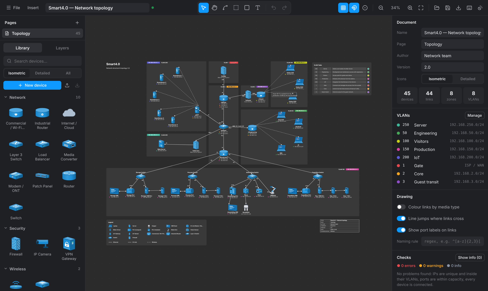
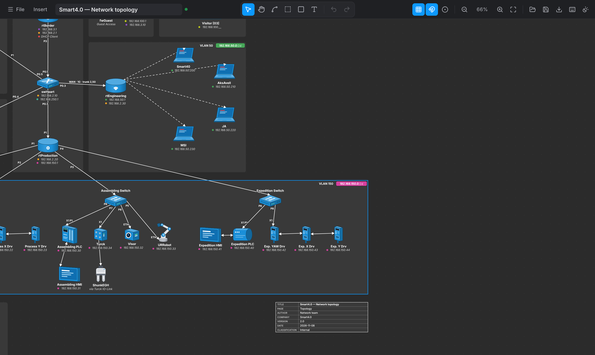
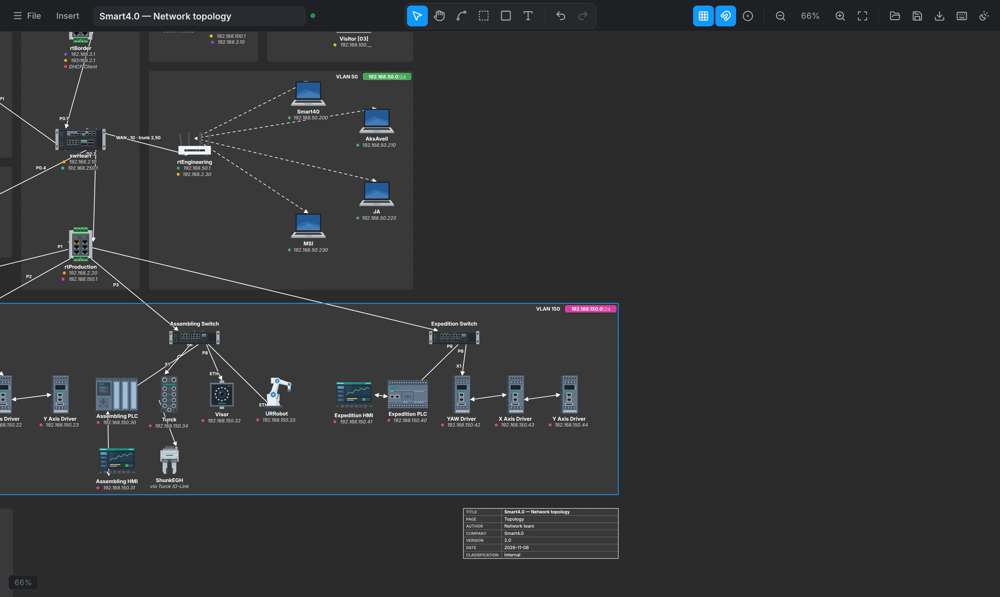
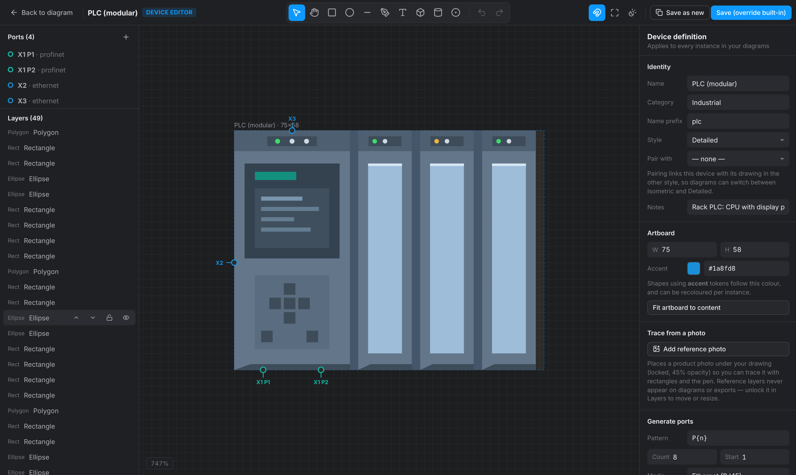
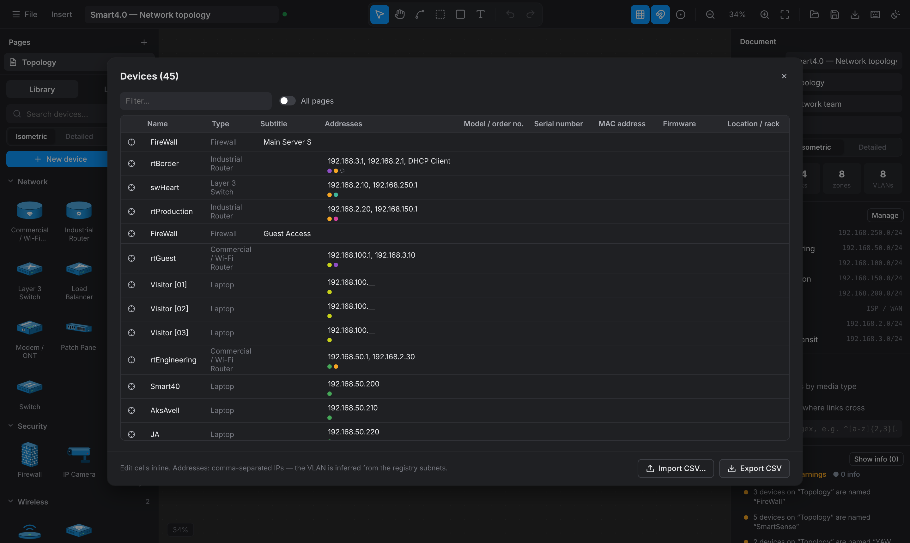

# Network Canvas

**A free, offline, single-file network & OT diagram editor** — built by a network/security engineer who got tired of drawing switches in Figma.

Network Canvas knows what a network is: devices have **ports** with media types and capacities, links snap port-to-port and refuse impossible cables, zones are bound to a **VLAN registry** (subnet, colour, description), every IP gets its VLAN's coloured dot, and a **checks** panel flags duplicate IPs, addresses outside their subnet, over-subscribed ports and unconnected devices. It ships with two complete icon styles — an **isometric** blue/white set and a **detailed** front-view set — that any diagram can switch between, plus a Figma-like **device editor** to draw your own.

Everything runs in the browser from one HTML file: no install, no account, no internet.



<p align="center">
  
  
</p>

## Get it

- **Download** `NetworkCanvas.html` from the [latest release](../../releases/latest) and double-click it. Chrome, Edge or Firefox. Works fully offline.
- Or **use it online**: <https://akira-rosa.github.io/networkcanvas/> (the same file, served from GitHub Pages).
- Diagrams autosave in your browser; use **File → Save to file** (`Ctrl+S`) for `.networkcanvas.json` files you can version, share or back up.

## What it does

**Draw**
- Infinite canvas: pan, zoom, dot grid, snap, smart alignment guides, marquee and multi-select, align/distribute, z-order, lock/hide, groups (`Ctrl+G`), layers, multiple pages, unlimited undo.
- **Zones bound to VLANs** — the subnet pill and colour come from the registry; drag a zone and its contents come along (`Alt` moves the zone alone).
- **Port-aware links** — drag from a port (press `P` to show all) to another device. Ports light up by media; incompatible media or full ports are refused. Port names become the link labels. Straight / orthogonal / curved routing, bend points, arrows, dashes, labels, and **speed / VLANs / cable ID** chips.
- Line jumps where links cross; colour links by media; parallel links fan out automatically.
- Auto **legend** (device types and link types in use), **VLAN table**, **title block** (author, version, date, classification), callouts with leader lines and `{name} {ip} {prop:model}` placeholders, images/logos, text and boxes.
- Drill-down: any device or zone can open another page.

**Document**
- Devices carry a name, subtitle, per-VLAN addresses and property fields (model, serial, firmware, location… per device type).
- **Checks** (Document panel): duplicate IPs across pages, IPs outside their VLAN subnet, dangling VLANs, duplicate names, over-capacity ports, media mismatches, unconnected devices, optional naming convention (regex). Click an issue to jump to it.
- **Device table** (`Ctrl+Shift+D`): spreadsheet view of every device, inline editing, and **CSV import** with column mapping (create or update by name; VLANs inferred from IPs).
- Next-free-IP suggestion per VLAN; the VLAN is inferred when you type an address.
- **Find** (`Ctrl+F`) across names, addresses, properties and texts on all pages.

**Icons & library**
- **Isometric** set (44 devices) in the blue/white schematic style and a **detailed** set (44 devices) of flat front-view product illustrations, from core switches to PLCs, drives, IO-Link masters, robots, HMIs, UPSs, phones and patch panels. Vendor models included (Siemens S7-1200/1500, IOT2050, Dell PowerEdge, Keyence, Dosetec).
- Switch a whole diagram between styles with one click; port names are identical across styles so links stay attached. Mix styles per device if you want.
- **Device editor**: rectangles, ellipses, pen/polygon with point editing, text, isometric box & cylinder primitives with automatic shading, gradients, per-corner radii, rotation, align/distribute, repeat/array, trace a reference photo, SVG import as editable shapes, copy/paste style. Place **ports** with media, exit side and capacity — or generate `Gi1/0/{n}` runs — and define property templates. Save to your library, export/import library packs, override or reset built-ins.

**Output**
- PNG (1–4×), SVG (fonts embedded), **PDF/print** (one sheet per page), **interactive HTML** (a self-contained viewer with pan/zoom, pages, search, hover cards and device details — and an *Edit* button that turns it back into the full editor), device inventory CSV and **cable schedule** CSV.
- Light and dark themes (follows your OS by default); exports can use either.

<p align="center">
  
  
</p>

## Keyboard

`V` select · `H` hand · `C` connect · `Z` zone · `R` box · `T` text · `P` show ports · `Ctrl+F` find · `Ctrl+E` export · `Ctrl+Shift+D` device table · `Ctrl+G` group · `Ctrl+Shift+A` auto-arrange · `Ctrl+\` hide panels · `Shift+1` fit · `Shift+2` zoom to selection · `?` all shortcuts

## Develop

```bash
npm install
npm run dev          # http://localhost:5173
npm test             # unit tests (vitest)
npm run build        # dist/NetworkCanvas.html — the single offline file
npm run e2e          # Playwright smoke test against the built file (npx playwright install chromium once)
npm run sheet iso out.png   # contact sheet of the icon library, for reviewing icons
```

Stack: React 19, TypeScript, Vite (single-file build), zustand + immer, hand-written SVG renderer, IndexedDB autosave. No backend.

```
src/
  model/      types · geometry (ports, routing, jumps) · checks · layout · factory
  library/    built-in devices as data (iso*, detailed*, models) · draw.ts builder API · sample diagram
  render/     ShapeView (device graphics) · DiagramLayer (pure page renderer, used for export) · theme
  canvas/     Canvas.tsx — interaction (pan/zoom, select, move, resize, guides, port linking, waypoints)
  panels/     TopBar · LeftPanel (pages, library, layers) · Inspector · Find · Export · DeviceTable · Modals
  editor/     the device editor
  viewer/     read-only viewer used by the interactive HTML export
  store/      zustand store (undo/redo, icon styles) · persistence (IndexedDB, files, libraries)
  export/     SVG / PNG / PDF / interactive HTML / CSV
```

See [docs/ARCHITECTURE.md](docs/ARCHITECTURE.md) for the data model and design decisions, [docs/ICON_GUIDE.md](docs/ICON_GUIDE.md) to add icons, and [docs/COMPETITIVE_ANALYSIS.md](docs/COMPETITIVE_ANALYSIS.md) for how Network Canvas compares with Cisco's tools, draw.io, Visio, Lucidchart and NetBox.

## File format

`.networkcanvas.json` is plain JSON with stable ids and sorted keys (git-friendly): pages → nodes & links, the VLAN registry, document metadata, and embedded copies of any custom device definitions so a file opens anywhere. See `src/model/types.ts`.

## Roadmap

Rack elevations (U-snapped, front/rear) · collapsible groups with drill-down · polygon/auto-hull zones · LAG/port-channel bundling · conditional formatting rules · NetBox import/export (devicetype-library YAML) · a third, Cisco-style "logical" icon set · cable tracing through patch panels · L2/L3 derived views · touch support · translations.

Contributions welcome — see [CONTRIBUTING.md](CONTRIBUTING.md).

## License

[MIT](LICENSE). Built-in icons are original artwork, also MIT. Vendor names identify compatible equipment and remain the property of their owners.
